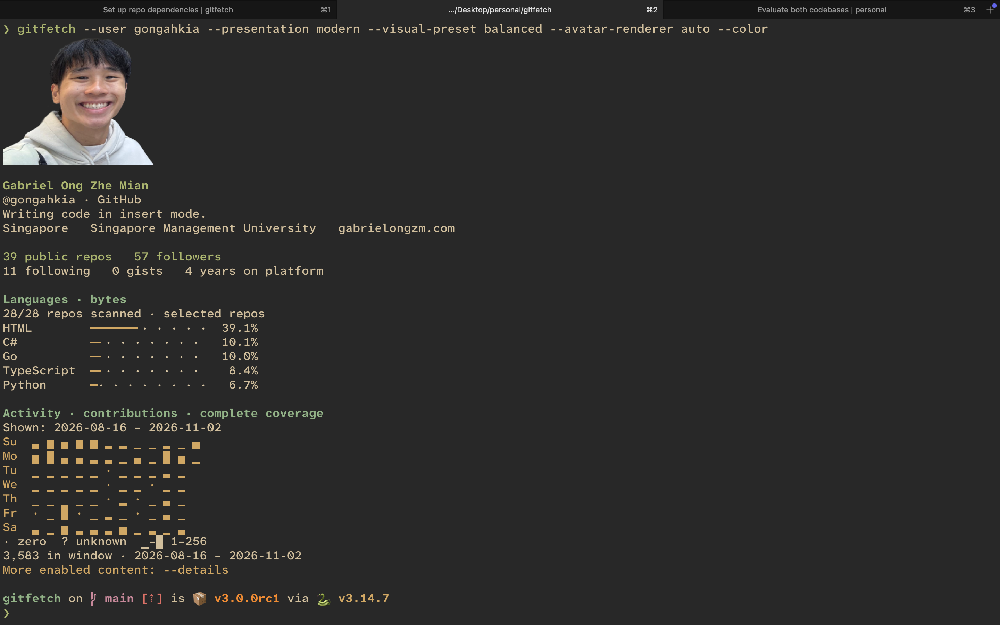
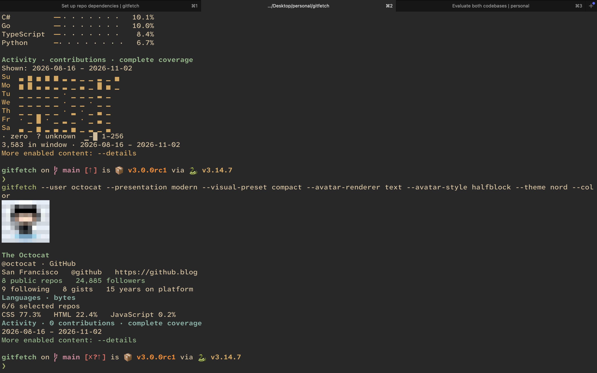
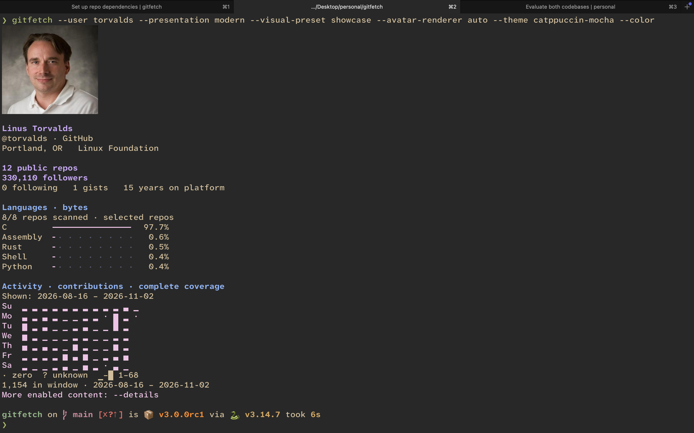
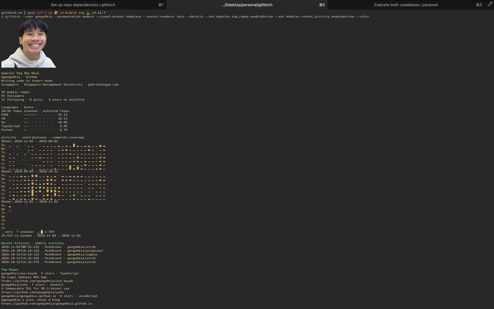
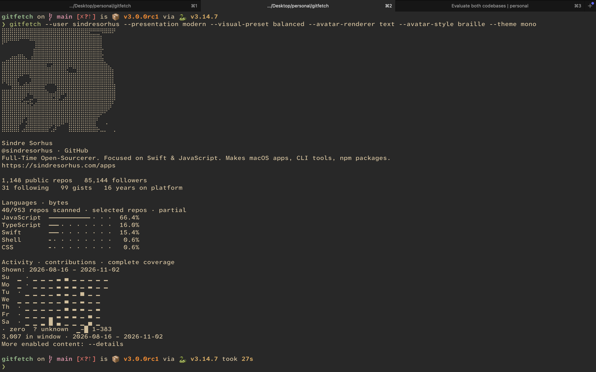

[](https://github.com/gongahkia/gitfetch/releases/tag/1.0)
[](https://github.com/gongahkia/gitfetch/releases/tag/2.0)


# `Gitfetch` 🛻

Serving you [snapshots](#support) of your [Git Provider](https://git-scm.com/) [profile](#support) in the [CLI](https://en.wikipedia.org/wiki/Command-line_interface) at [blazingly fast](https://news.ycombinator.com/item?id=23874245) speeds.

## Stack

* *Scripting*: [Python](https://www.python.org/), [Pip](https://pypi.org/project/pip/), [Pillow](https://pypi.org/project/Pillow/), [Requests](https://pypi.org/project/requests/)
* *API*: [GitHub Rest API](https://docs.github.com/en/rest?apiVersion=2022-11-28), [GitLab REST API](https://docs.gitlab.com/api/rest/), [Bitbucket Cloud REST API](https://developer.atlassian.com/cloud/bitbucket/rest/), [Gitea REST API](https://docs.gitea.com/api/), [Forgejo API](https://forgejo.org/docs/latest/user/api-usage/)

## Screenshots

<div align="center">
    
    
    
</div>

<div align="center">
    
    
    
</div>

## Usage

> [!WARNING]  
> `Gitfetch` requires Python 3.11+ and Pillow 13. 

The below instructions are for locally installing and running `Gitfetch`.

1. First run the below to execute the local set-up.

```console
$ git clone https://github.com/gongahkia/gitfetch
$ cd gitfetch
$ uv tool install --python 3.12 .
$ gitfetch config wizard 
```

2. Then run any of the below commands to interact with `Gitfetch`'s functionality.

```console
$ gitfetch # uses saved username
$ gitfetch --user octocat # specify username
$ gitfetch --no-avatar # stats only, no ASCII art

$ gitfetch --provider gitlab --user gitlab-org # render a GitLab user or namespace
$ gitfetch --provider bitbucket --user atlassian # render a Bitbucket workspace
$ gitfetch --provider codeberg --user forgejo # render a Codeberg profile or org
$ gitfetch --provider gitea --user gitea # render a Gitea.com profile or org

$ gitfetch --presentation modern # responsive terminal profile, also available in captured/plain output
$ gitfetch --presentation classic # preserve the previous terminal style

$ gitfetch --details # expand enabled modern sections, may scroll, collects no additional data
$ gitfetch --offline # cached provider data and avatars only, missing avatars are omitted
$ gitfetch --refresh # bypass response and avatar cache reads
$ gitfetch --token ghp_xxxx # authenticated, also accepts provider env variables such as GITHUB_TOKEN, GITLAB_TOKEN, BITBUCKET_TOKEN, GITEA_TOKEN, FORGEJO_TOKEN, or CODEBERG_TOKEN

$ gitfetch repo octocat/Hello-World # render a repository profile
$ gitfetch org github # render an organization profile
$ gitfetch compare octocat torvalds # compare two or more users side-by-side

$ gitfetch --provider gitlab repo gitlab-org/gitlab # render a GitLab project
$ gitfetch --provider bitbucket repo atlassian/atlassian-event # render a Bitbucket repository
$ gitfetch --provider codeberg repo forgejo/forgejo # render a Codeberg repository
$ gitfetch --provider gitea repo gitea/tea # render a Gitea.com repository
$ gitfetch --format json --user octocat # machine-readable output
$ gitfetch --format svg --save profile.svg --user octocat # terminal render as SVG
$ gitfetch --format card --save profile-card.svg --user octocat # shareable profile card
$ gitfetch --format png --save profile-card.png --user octocat # shareable PNG card
```

## Config

`Gitfetch` by default reads `~/.config/gitfetch/config.toml` at your global path. You can specify another file with `--config`.

```console
$ gitfetch config init --preset compact
$ gitfetch config init --preset full --force
$ gitfetch --config ./gitfetch.toml --user octocat
$ gitfetch --provider gitlab --base-url https://gitlab.example.com/api/v4 --user alice
$ gitfetch --provider gitea --base-url https://git.example.com/api/v1 --user alice
$ gitfetch --provider forgejo --base-url https://forgejo.example.com/api/v1 --user alice
```

Or override any dotted config value for one run.

```console
$ gitfetch --set display.avatar=false
$ gitfetch --set profile.provider=gitlab
$ gitfetch --set providers.gitlab.base_url=https://gitlab.example.com/api/v4
$ gitfetch --set providers.forgejo.base_url=https://forgejo.example.com/api/v1
$ gitfetch --set modules.languages.limit=3
$ gitfetch --set modules.languages.max_repos=0 # scan every repo, default samples 40 to limit API cost
$ gitfetch --set repo_filters.exclude_forks=false
```

## Support

`Gitfetch` currently supports the below 6 providers.

* [GitHub](https://github.com/)
* [GitLab](https://gitlab.com/)
* [Bitbucket Cloud](https://bitbucket.org/product)
* [Gitea](https://about.gitea.com/)
* [Codeberg](https://codeberg.org/)
* [Forgejo](https://forgejo.org/)

`Gitfetch` is currently able to retrieve the below values from your Git provider(s).

* Followers
* Public repos
* Contribution
* Hours since joining
* Days since last commit
* Languages with provider-specific units *(bytes, repository prevalence, or primary-language repository counts)*
* Provider-available repository stats, language data, contributors, and recent commits
* Organization mode with organization stats, repositories, and public members heatmap 
